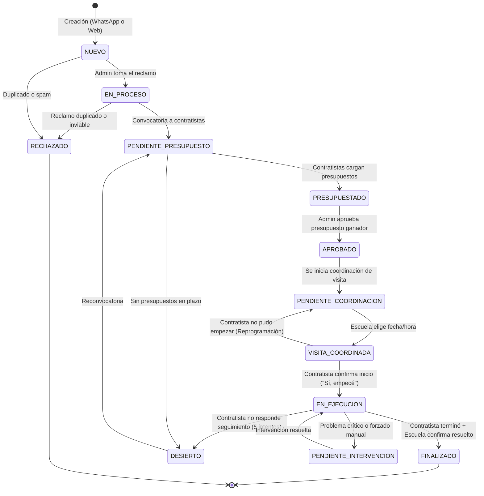
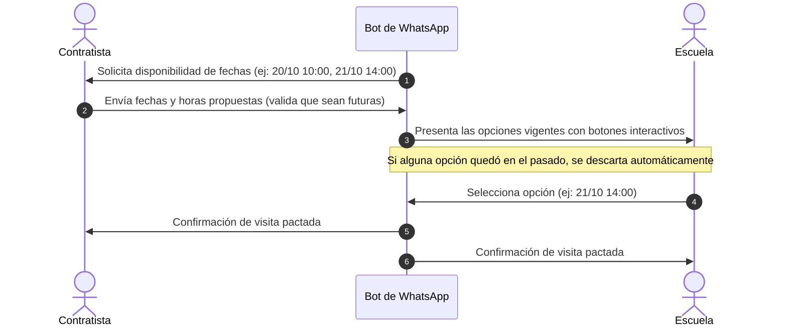
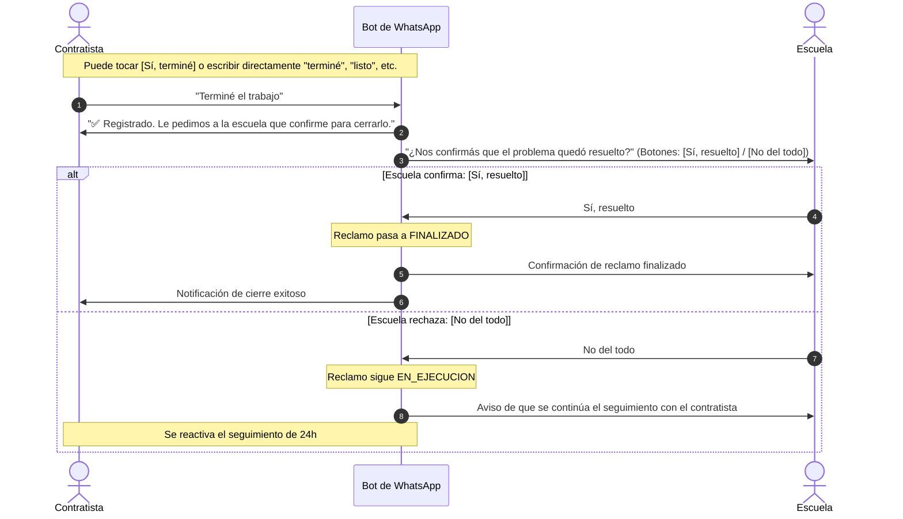

# InfraBot UTN — Mapa Completo de Flujos y Funcionalidades

Este documento describe la arquitectura funcional, el ciclo de vida de los reclamos, todos los flujos principales y variantes, y los módulos auxiliares que componen el sistema **InfraBot**.

---

## 1. Actores del Sistema

| Actor | Canal Principal | Rol y Responsabilidades |
| :--- | :--- | :--- |
| **Escuela (Directores / Creadores)** | WhatsApp / Web | Reporta reclamos de infraestructura, aporta fotos/videos, elige horarios de visita y confirma la resolución final del trabajo. |
| **Contratista** | WhatsApp | Recibe pedidos de visita, carga disponibilidad, confirma inicio de obra, envía fotos de avance y reporta cuándo terminó el trabajo. |
| **Consejo Escolar / Administrador** | Panel Web | Triaje de reclamos, evaluación y aprobación de presupuestos auditados por IA, supervisión de reclamos desiertos o con intervención, simulación de tiempo. |
| **Operador Humano** | Panel Web | Atiende en tiempo real a usuarios de WhatsApp que solicitaron hablar con una persona (*"operador"*). |
| **Sistema Automatizado / IA** | Backend & Schedulers | Clasificación, transcripción de audios, detección de duplicados, auditoría de precios, envío de recordatorios y gestión de estados de conversación. |

---

## 2. Máquina de Estados del Reclamo

---

## 3. El Viaje del Reclamo: Paso a Paso

### Fase 1: Creación y Triaje
1. **Canal WhatsApp:**
   - **Modo Asistido por IA (audio/texto libre/imágenes):** El usuario puede enviar notas de voz (transcritas localmente por Whisper), fotos o un texto contando lo que pasa. El LLM extrae la escuela, descripción del problema, categoría y urgencia sugerida.
   - **Modo Guiado (Paso a paso):** El bot solicita Escuela → Descripción → Fotos/Videos (hasta que el usuario escriba *listo*).
   - **Detección de Duplicados:** La IA evalúa reclamos abiertos en la misma escuela y advierte si ya existe uno similar.
2. **Canal Web:** Directivos o personal del Consejo pueden registrar reclamos mediante formulario tradicional.
3. El reclamo ingresa en estado **`NUEVO`** y pasa a **`EN_PROCESO`** para asignación.

---

### Fase 2: Presupuestación y Auditoría por IA
1. El reclamo pasa a **`PENDIENTE_PRESUPUESTO`**.
2. Los contratistas habilitados cargan sus presupuestos detallando ítems (mano de obra, materiales), montos y plazos.
3. Al recibir propuestas, pasa a **`PRESUPUESTADO`**.
4. **Auditoría de Costos con IA:**
   - El sistema analiza automáticamente cada ítem comparándolo con bases históricas de precios de referencia.
   - Alerta al administrador con semáforos: *Dentro de rango*, *Atención* o *Sobreprecio sospechoso*.

---

### Fase 3: Adjudicación y Aprobación
1. El Administrador revisa los presupuestos y su auditoría de costos en el panel web.
2. Elige el presupuesto ganador y hace clic en **Aprobar**.
3. **Comportamiento visual:**
   - Para el presupuesto ganador aprobado, la sección de auditoría se oculta automáticamente y se exhibe una insignia destacada de **Aprobado**.
   - Los demás presupuestos pasan a estado `RECHAZADO`.
4. El reclamo pasa a estado **`APROBADO`** y automáticamente a **`PENDIENTE_COORDINACION`**.

---

### Fase 4: Coordinación de Visita (CU-Visita)
El bot de WhatsApp coordina la visita de forma autónoma entre ambas partes:

- **Recordatorios Automáticos:**
  - **Día anterior:** Notificación por WhatsApp a la escuela y contratista recordando la visita de mañana.
  - **Mismo día:** Recordatorio por la mañana indicando que la visita se llevará a cabo hoy en el horario acordado.

---

### Fase 5: Inicio de Obra
1. Al cumplirse el horario de la visita acordada, el sistema envía un WhatsApp al contratista:
   > *"🛠️ Hoy era la visita acordada... ¿Pudiste empezar el trabajo?"*  
   > Botones: **[Sí, empecé]** | **[No pude]**
2. **Si responde "No pude":**
   - El reclamo vuelve a `PENDIENTE_COORDINACION`.
   - Se le solicita al contratista una nueva terna de disponibilidades para reprogramar.
3. **Si responde "Sí, empecé":**
   - El reclamo pasa a **`EN_EJECUCION`**.
   - El bot le informa inmediatamente:
     > *"🛠️ ¡Genial! El reclamo #X quedó **en ejecución**.*  
     > *Te vamos a consultar mañana a esta misma hora para ver cómo viene el trabajo.*  
     > *Si terminás antes, podés avisarnos directamente por acá enviando un mensaje que diga **terminé** o **listo** para confirmar que el trabajo está terminado."*

---

### Fase 6: Ejecución, Avances y Seguimiento (24 Horas)
1. **Avance Proactivo del Contratista:**
   - Durante la obra, el contratista puede enviar fotos, videos o mensajes de texto.
   - Cada envío se adjunta al historial del reclamo como evidencia visible en el panel.
2. **Seguimiento a las 24 horas (`SEGUIMIENTO_HORAS=24`):**
   - Al día siguiente a la misma hora del inicio de obra, el bot pregunta al contratista:
     > *"¿Terminaste el trabajo?"*  
     > Botones: **[Sí, terminé]** | **[Todavía no]**
3. **Si responde "Todavía no":**
   - El bot consulta: *"¿Cuánto tiempo estimás que te falta?"* (ej: *"2 días"*, *"5 horas"*).
   - El sistema calcula y agenda la próxima pregunta para esa fecha (`proxima_pregunta`), pausando preguntas intermedias.
4. **Si el contratista deja de responder:**
   - Se reitera el recordatorio hasta un máximo de 5 intentos.
   - Si no hay respuesta tras el 5° intento, el reclamo escala automáticamente a **`DESIERTO`** para reconvocar contratistas.

---

### Fase 7: Finalización y Confirmación de la Escuela (CU-05)
El cierre del reclamo **nunca es unilateral**; requiere el visto bueno de la escuela.

---

## 4. Variantes y Flujos de Excepción

### 4.1 Mensaje directo de fin de obra (proactivo)
- El contratista **no está obligado a esperar las 24 horas** para que el bot le pregunte.
- Puede escribir en cualquier momento frases como: *"terminé"*, *"termine"*, *"listo"*, *"ya terminé el trabajo"*, *"finalicé"*.
- El bot reconoce la intención, registra el reporte en el historial y dispara la consulta de satisfacción a la escuela.
- **Protección contra repetición:** Si el contratista escribe *"terminé"* nuevamente mientras la escuela aún no respondió, el bot le confirma amablemente que ya está registrado y se espera la validación de la escuela, evitando spamear a la institución.

### 4.2 Horarios pasados al coordinar visitas
- Al momento de elegir turnos de visita, el sistema compara las opciones contra el reloj virtual actual.
- Si una opción ya venció, se filtra de la lista.
- Si el usuario intenta seleccionar un horario vencido, se le informa y se le ofrecen solo los horarios aún vigentes.
- Si todos los horarios vencieron, el sistema solicita automáticamente al contratista una nueva tanda de disponibilidad.

### 4.3 Intervención Manual / Forzada del Consejo
- Si ocurre un conflicto o se requiere trabar el avance para inspección, un administrador puede pasar el reclamo a **`PENDIENTE_INTERVENCION`**.
- La intervención congela los schedulers automáticos de recordatorios.
- Cuando el Consejo lo resuelva, puede reintegrarlo a `EN_EJECUCION`.

---

## 5. Módulos y Funcionalidades Transversales

### 5.1 Simulador de Tiempo Virtual (Exclusivo Admin)
Diseñado para demostraciones y pruebas completas del ciclo de vida sin esperar días reales:
- **Reloj Virtual Centralizado (`reloj.py`):** Mantiene un offset temporal en memoria sincronizado en todo el backend.
- **Control en Barra Superior:** Badge con la fecha/hora virtual actual y botón de acceso rápido.
- **Avance Temporal:**
  - Saltos rápidos: **+1 Hora**, **+6 Horas**, **+1 Día**, **+7 Días**.
  - Selector de fecha y hora personalizada.
  - Botón para restablecer al tiempo real.
- **Simulador de WhatsApp:** Interfaz web para visualizar las conversaciones simuladas de cualquier número telefónico (escuela o contratista) y probar la interacción bidireccional en tiempo real.

### 5.2 Chat con Operador Humano (Mesa de Ayuda)
- Si un usuario escribe *"operador"*, *"humano"* o *"ayuda humana"*, el bot se desactiva temporalmente para ese número.
- Si está en horario de atención, crea una sesión en la bandeja de **Conversaciones** del panel web para que un operador humano chatee directamente.
- Si está fuera de horario, le informa el horario de atención.
- El usuario o el operador pueden presionar *"Volver al bot"* o enviar *"cancelar"* para reactivar el asistente automatizado.

### 5.3 Anti-Spam y Rate Limiting
- Ventana móvil de frecuencia de mensajes (máximo 15 mensajes por minuto).
- Si un usuario sobrepasa el umbral, se le aplica un bloqueo temporal de 5 minutos, protegiendo los recursos de la API y el backend.

### 5.4 Auditoría de Presupuestos con IA
- Motor de validación de costos unitarios y totales frente a datos de referencia.
- Detección de desviaciones estadísticas en materiales y mano de obra.
- Interfaz clara para administradores con desglose de ítems auditados.

